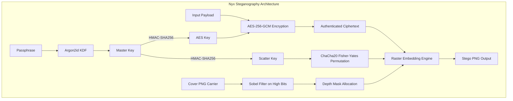

<p align="center">
  <h1 align="center">Nyx</h1>
  <p align="center">Cryptographically authenticated, edge-adaptive image steganography in Java 21</p>
  <p align="center">
    
    
    
  </p>
</p>

Nyx is a steganography tool designed for bit-perfect binary data embedding inside lossless PNG images. It integrates authenticated cryptography (**Argon2id** and **AES-256-GCM**), key-derived pseudo-random pixel scattering (**ChaCha20**), and edge-adaptive depth allocation (**Sobel filter on invariant bitplanes**) with direct raster buffer manipulation. Nyx provides confidentiality, tamper detection, and localized distortion control; it does not claim cryptographic undetectability against high-order statistical steganalysis.

---

## Features

- **Authenticated Cryptography**: Key derivation via Argon2id (64 MiB, 3 iterations) and payload encryption via AES-256-GCM with a 128-bit authentication tag and Additional Authenticated Data (AAD).
- **Subkey Separation**: Independent AES and pixel-scattering keys derived via HMAC-SHA256 from the master key.
- **Key-Driven Pixel Scattering**: Payload pixels scattered across the carrier via Fisher-Yates permutation driven by a ChaCha20 keystream.
- **Edge-Adaptive Depth Allocation**: Embedding depth (0 to 3 bits per RGB channel) allocated based on Sobel edge gradients computed exclusively over invariant upper bitplanes.
- **Direct Raster Access**: Direct backing array access for `TYPE_INT_ARGB` images, bypassing coordinate translation overhead.
- **Lossless Carrier Safeguards**: Enforces lossless PNG output containers to preserve bit-level embedding integrity.

---

## How It Works



1. **Key Derivation**: Argon2id hashes the user passphrase with a per-image random salt to produce a 32-byte master key.
2. **Key Separation**: HMAC-SHA256 derives isolated encryption (`aesKey`) and scattering (`scatterKey`) keys with distinct domain labels. Passphrase and master key memory arrays are wiped immediately after derivation.
3. **Edge Invariance**: The 3x3 Sobel filter operates strictly on the upper 5 bitplanes (`channel & 0xF8`), ensuring gradient values are identical before and after embedding.
4. **Embedding**: The payload is encrypted with AES-256-GCM and embedded across RGB channels using the derived pixel coordinates and depths.

---

## Requirements

- **Java**: JDK 21 or later
- **Maven**: Apache Maven 3.9+

---

## Quick Start

### Direct Execution (Recommended)

Nyx includes launcher scripts that automatically resolve dependencies and build the binary on first execution if not already compiled:

**Linux / macOS:**
```bash
chmod +x ./nyx
./nyx
```

**Windows (PowerShell):**
```powershell
.\nyx.ps1
```

**Windows (Command Prompt):**
```cmd
nyx.bat
```

*Note: Any CLI flags (such as `--no-scatter` or `--no-adaptive`) can be passed directly to the launcher scripts.*

### Manual Build & Run

Alternatively, compile and package the application manually using Maven:

```bash
mvn clean package dependency:copy-dependencies -DoutputDirectory=target/lib
```

Execute Nyx using the Java module path:

**Windows (PowerShell / Command Prompt):**
```cmd
java --module-path "target/nyx-stegano-1.0-SNAPSHOT.jar;target/lib" -m org.ghost/org.ghost.Main
```

**Linux / macOS:**
```bash
java --module-path "target/nyx-stegano-1.0-SNAPSHOT.jar:target/lib" -m org.ghost/org.ghost.Main
```

---

## Usage

### Interactive CLI Walkthrough

#### 1. Cloak (Encrypt & Embed)

```text
******************************************
*            NYX STEGANOGRAPHY           *
*       Bit-Perfect Binary Cloaking      *
******************************************

Embedding Mode: Key-Driven Scattered (default) | Depth: Sobel Adaptive (default)
Select Operation Mode:
[1] Encrypt & Hide (Cloak)
[2] Reveal & Decrypt (Uncloak)
Choice (1/2): 1
Enter password: 
Enter path of the file to hide: secret.zip

--- Carrier Image (Container) Selection ---
[1] Manual path
[2] Auto-fetch Unsplash (HD)
Choice (1/2): 1
Enter carrier image path: cover.png
Deriving key, this can take a few seconds...
Encrypting and cloaking... Done!
Save output as (default: output.png): stego.png
SUCCESS! Digital Ghost saved to: stego.png (495968 bytes)
```

#### 2. Uncloak (Extract & Decrypt)

```text
Select Operation Mode:
[1] Encrypt & Hide (Cloak)
[2] Reveal & Decrypt (Uncloak)
Choice (1/2): 2
Enter password: 

--- Decryption Flow ---
Enter Ghost image path: stego.png
Deriving key, this can take a few seconds...
Extracting and decrypting... Done!
Save restored file as (extension will be added automatically): restored_secret
SUCCESS! File restored as: restored_secret.zip (143871 bytes)
```

### CLI Flags

By default, Nyx enables both key-driven scattering and edge-adaptive depth. Flags allow adjusting the active embedding mode:

- `--no-scatter`: Disables pseudo-random scattering; embeds payload pixels sequentially after the header.
- `--no-adaptive`: Disables Sobel edge-adaptive depth; embeds at constant depth 1 (1 bit per channel).
- `--no-scatter --no-adaptive`: Disables both features (sequential embedding at constant depth 1).

### Environment Variables

- **`NYX_PASSWORD`**: Optional. When set, Nyx reads the passphrase from this variable instead of prompting via `System.console()`.
- **`UNSPLASH_ACCESS_KEY`**: Required only when selecting Option 2 (Auto-fetch Unsplash) in the carrier selection menu.

---

## Embedding Modes

| Mode | CLI Flags | Pixel Ordering | Depth Allocation | Trade-off |
| :--- | :--- | :--- | :--- | :--- |
| **Default** | *(none)* | ChaCha20 scattered | Sobel adaptive (0..3) | Highest capacity in texture; non-sequential scattering |
| **Sequential Adaptive** | `--no-scatter` | Sequential (`134..N-1`) | Sobel adaptive (0..3) | High capacity in texture; sequential pixel coordinates |
| **Scattered Constant** | `--no-adaptive` | ChaCha20 scattered | Constant 1 bit/channel | Uniform bit modification; no smooth-region skipping |
| **Sequential Constant** | `--no-scatter --no-adaptive` | Sequential (`134..N-1`) | Constant 1 bit/channel | Baseline sequential layout; uniform depth |

### Capacity Formulation

Carrier capacity is calculated from available payload pixels (`totalPixels - 134`):

$$\text{Usable Capacity (bytes)} = \left\lfloor \frac{\text{AvailableBits}}{8} \right\rfloor - (17 + \text{extLen})$$

Framing overhead consists of:
- **16 bytes**: AES-256-GCM authentication tag
- **1 byte**: Extension length prefix (`extLen`)
- **0 to 16 bytes**: ASCII file extension (`extLen`)

---

## File Format & Cryptographic Protocol

<details>
<summary>Click to view 50-byte header specification and key hierarchy</summary>

### 50-Byte Envelope Header Layout

The header is embedded sequentially across pixels `0..133` (1 bit per channel across R, G, B order, MSB-first):

| Offset | Field | Size | Type | Description |
| :--- | :--- | :--- | :--- | :--- |
| `0..3` | **Magic** | 4 bytes | Raw | `0x4E, 0x59, 0x58, 0x01` (`NYX\x01`) |
| `4` | **Cipher ID** | 1 byte | u8 | `0x01` = AES-256-GCM |
| `5` | **KDF ID** | 1 byte | u8 | `0x01` = Argon2id |
| `6` | **Flags** | 1 byte | u8 | Bit 0 (`0x01`): Scattered; Bit 1 (`0x02`): Adaptive |
| `7` | **Profile ID** | 1 byte | u8 | `0x01` = `DEFAULT` profile (thresholds 16, 48, 112) |
| `8..11` | **Argon2 Memory** | 4 bytes | u32 (BE) | Memory parameter in KiB (default `65536` = 64 MiB) |
| `12` | **Argon2 Iterations** | 1 byte | u8 | Iteration count (default `3`) |
| `13` | **Argon2 Parallelism** | 1 byte | u8 | Thread parallelism (default `1`) |
| `14..29` | **Salt** | 16 bytes | Raw | Cryptographic salt for Argon2id |
| `30..41` | **Nonce** | 12 bytes | Raw | AES-256-GCM initialization vector |
| `42..45` | **Ciphertext Length** | 4 bytes | u32 (BE) | Length of ciphertext including 16-byte GCM tag |
| `46..49` | **CRC-32** | 4 bytes | u32 (BE) | CRC-32 checksum computed over header bytes `0..45` |

*Header bytes `0..45` serve as Additional Authenticated Data (AAD) for AES-256-GCM verification.*

### Key Hierarchy

```text
Passphrase (char[]) + Salt (16 bytes random)
           │
           ▼
     Argon2id (v0x13, 64 MiB RAM, 3 iterations, p=1)
           │
           ▼
     Master Key (32 bytes)
     ┌─────┴─────────────────────────────────────┐
     ▼                                           ▼
HMAC-SHA256("nyx/aes-256-gcm" || 0x01)     HMAC-SHA256("nyx/scatter" || 0x01)
     │                                           │
     ▼                                           ▼
AES-256 Key (32 bytes)                     Scatter Key (32 bytes)
     │                                           │
     ▼                                           ▼
AES-256-GCM (12-byte nonce)                ChaCha20 Keystream
(AEAD over payload + AAD bytes 0..45)      (Fisher-Yates pixel shuffle)
```

### Depth Profile Thresholds (`DEFAULT`)

The Sobel edge gradient $G = |G_x| + |G_y|$ maps to embedding depths via three thresholds ($T_1 = 16, T_2 = 48, T_3 = 112$):
- **Smooth regions** ($G < 16$): **Depth 0** (pixels skipped; 0 bits embedded)
- **Low gradient** ($16 \le G < 48$): **Depth 1** (1 bit/channel = 3 bits/pixel)
- **Medium gradient** ($48 \le G < 112$): **Depth 2** (2 bits/channel = 6 bits/pixel)
- **High gradient** ($G \ge 112$): **Depth 3** (3 bits/channel = 9 bits/pixel)

</details>

---

## Security Notes & Limitations

1. **Lossless PNG Carriers Only**: Embedded data cannot survive lossy compression (JPEG), resizing, cropping, or color space transformations. LSB alterations cause AES-GCM authentication tag verification to fail; while tampering is detected, payload recovery is impossible.
2. **Statistical Detectability**: While key-driven scattering and edge-adaptive allocation reduce first-order artifacts (such as step discontinuities on Chi-square curves), they reduce but do not eliminate detectability against targeted high-order steganalysis tools.
3. **Fixed Header Structure**: The 50-byte header resides at sequential pixels `0..133` with magic identifier `NYX\x01`, which serves as an explicit indicator that the image is a Nyx container.
4. **Uniform Authentication Failure**: An incorrect passphrase, corrupted ciphertext, or modified carrier all produce the exact same error message: `[SECURITY ALERT]: wrong password or the carrier was modified/recompressed`. This prevents cryptographic padding or distinguishing oracles.
5. **Passphrase Entropy**: Confidentiality against offline brute-force attacks depends entirely on the entropy of the user-supplied passphrase.
6. **Pixel Count Limit**: Image pixel count is guarded at `MAX_PIXEL_COUNT = 33,554,432` pixels (32 Mi-pixels, e.g., 8192×4096) to prevent unbounded memory allocation and ensure index buffers (`int[]`) consume at most 128 MB heap memory.
7. **Carrier Reuse**: Never distribute or publish the original unmodified cover image alongside a stego carrier, as a simple pixel subtraction immediately isolates the modified bitplanes.

---

## Project Structure

```text
src/main/java/
├── module-info.java                # JPMS module declaration (org.ghost)
└── org/ghost/
    ├── Main.java                   # Interactive CLI entry point and menu router
    ├── core/                       # Steganographic core engine and layout strategies
    │   ├── AbstractSteganoEngine.java
    │   ├── AdaptiveLayout.java     # Sobel edge-adaptive bit depth modulator
    │   ├── DepthProfile.java       # Edge gradient threshold profiles
    │   ├── EmbeddingLayout.java    # Layout interface for pixel coordinate sources
    │   ├── EnvelopeHeader.java     # 50-byte authenticated binary header serialization
    │   ├── PayloadEnvelope.java    # Plaintext framing and file extension packing
    │   ├── RasterAccess.java       # Direct DataBufferInt array access with safety checks
    │   ├── ScatteredLayout.java    # ChaCha20-driven Fisher-Yates coordinate permutation
    │   ├── SequentialLayout.java   # Sequential coordinate generator
    │   ├── SobelEdgeDetector.java  # 3x3 Sobel filter operating on invariant bitplanes
    │   ├── SteganoEngine.java      # High-level cloak and reveal orchestration
    │   └── SteganoProtocol.java    # Protocol interface definitions
    ├── crypto/                     # Cryptographic primitives and key derivation
    │   ├── AESCipher.java          # Low-level AES-GCM engine
    │   ├── AuthenticatedCipher.java# Static AEAD encryption and decryption helpers
    │   ├── ChaCha20Stream.java     # Deterministic keystream generator for scattering
    │   ├── NyxKeyDerivation.java   # Argon2id KDF and HMAC-SHA256 subkey separation
    │   └── XORCipher.java          # Legacy cipher reference implementation
    ├── ui/
    │   └── MainApp.java            # JavaFX GUI application stub (not implemented)
    └── utils/
        ├── ImageManager.java       # Image format conversion and ARGB normalization
        └── UnsplashClient.java     # Unsplash HTTP client for automatic carrier downloads
```

---

## Testing & Benchmarks

### Standard Test Suite

Runs all unit, boundary, and property tests (53 tests):

```bash
mvn test
```

### End-to-End CLI Integration Suite

Validates full cloak and uncloak execution across multiple file formats (PDF, ZIP) and negative failure conditions:

```bash
mvn test -Dtest=CliIntegrationRunner
```

### Direct Raster Benchmarks

Measures memory allocation, execution time, and speedup comparing direct raster buffer manipulation against reference `getRGB`/`setRGB` across 1080p, 4K, and 8K resolutions:

```bash
mvn test -Dtest=RasterBenchmark
```

---

## Status & Roadmap

- **Graphical User Interface**: The JavaFX GUI (`org.ghost.ui.MainApp`) is currently a stub and not implemented. Nyx is operated through the command-line interface.
- **Payload-Aware Depth Cap**: A design note proposing adaptive depth capping ($D \in \{1, 2, 3\}$) to reduce distortion on small payloads is documented in [docs/depth_cap_design_note.md](docs/depth_cap_design_note.md).

---

## License & Author

- **License**: Released under the [MIT License](LICENSE).
- **Author**: Developed by [PixWizard](https://github.com/PixWizard).
